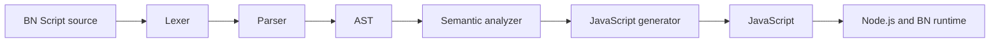

# BN Script

A Bangla-inspired programming language that compiles to JavaScript, with a runtime, command-line tools, an interactive REPL, and a VS Code extension.

BN Script explores language and developer-tool design through a complete compiler pipeline. Programs can use Bangla-inspired keywords, English aliases, or both.

```text
dhori nam = "Risat"

jodi nam == "Risat" {
    dekhi "Hello, BN Script"
}
```

The English forms include `let`, `const`, `if`, and `print`. See the [language specification](docs/language-spec.md) for the supported grammar.

**Status:** `0.1.0-alpha.0`. The language and tooling are experimental; APIs and syntax may change. AI helpers, an LSP, and VS Code Marketplace publication remain planned.

## Run a program

Requires Node.js 18 or newer. The compiler and runtime use Node's built-in APIs; development dependencies are needed for extension packaging.

```bash
git clone https://github.com/sayedrisat/bnscript.git
cd bnscript
npm ci
node src/cli.js check examples/variables.bn
node src/cli.js run examples/variables.bn
```

The example prints its name, version, and boolean value. Other runnable programs are in [examples/](examples/README.md).

| Command | Behavior |
| --- | --- |
| `node src/cli.js check examples/variables.bn` | Check syntax and semantics without executing |
| `node src/cli.js build examples/variables.bn` | Write generated JavaScript beside the source |
| `node src/cli.js run examples/variables.bn` | Compile and execute using the local runtime |
| `node src/cli.js examples/variables.bn` | Shorthand for `run` |
| `node src/cli.js repl` | Start the interactive REPL |

The package declares the `bn` executable. `npm link` makes it available for local development; it does not publish the package. See [CLI documentation](docs/cli.md).

## Compiler architecture



[`compile()`](src/compiler.js) coordinates the stages and returns `{ ast, js, diagnostics }`. Diagnostics stop code generation; the CLI and editor tooling share the compiler entry point.

| Component | Responsibility |
| --- | --- |
| [`src/lexer.js`](src/lexer.js), [`src/tokens.js`](src/tokens.js) | Tokenization and keyword recognition |
| [`src/parser.js`](src/parser.js), [`src/ast.js`](src/ast.js) | Grammar and source-located AST nodes |
| [`src/analyzer.js`](src/analyzer.js), [`src/scope.js`](src/scope.js) | Scope resolution, declarations, assignments, and control-flow diagnostics |
| [`src/generator.js`](src/generator.js) | JavaScript generation and runtime imports |
| [`src/runtime/`](src/runtime/) | Fetch, file, environment, wait, and runtime-error helpers |
| [`src/cli.js`](src/cli.js), [`src/repl.js`](src/repl.js) | Check/build/run commands and interactive evaluation |
| [`vscode/`](vscode/) | Syntax grammar, completion, hover information, commands, and diagnostics |

Read the [compiler architecture](docs/compiler-architecture.md) and [architecture audit](docs/ARCHITECTURE_AUDIT.md) for details. Some design documents include future work; source and tests establish the implemented behavior.

## Language capabilities

- Variables and constants, functions, conditionals, loops, arrays, and objects.
- Bangla-inspired keywords with English aliases.
- Imports/exports, async/await, top-level await, and error handling.
- Semantic checks for undeclared names, duplicate declarations, invalid assignment, and invalid control-flow placement.
- Source-located diagnostics with Bangla and English explanations.

Programs execute with the current Node process's permissions. File, environment, and network helpers use the host process's capabilities; BN Script is not an execution sandbox. No credentials are needed to compile local examples. A program using an external service supplies its own configuration.

## VS Code extension

The extension provides syntax highlighting, autocomplete, hover documentation, bilingual diagnostics, Problems-panel navigation, and check/build/run commands.

```bash
npm run build:vsix
```

Install `dist/bnscript-0.1.0-alpha.0.vsix` through **Extensions → … → Install from VSIX**, then open a `.bn` file. Marketplace publication, an LSP, code actions, semantic highlighting, and workspace symbol navigation remain future work.

## Verification

```bash
npm test
```

The Node test suite exercises lexer/parser behavior, semantic analysis, code generation, runtime helpers, CLI/REPL flows, and editor tooling. Run the suite rather than relying on a historical test count. This repository currently has no GitHub Actions test workflow.

## Contributing

Start with a reproducible language or tooling problem, check existing issues, and keep changes focused. Update examples and tests when a language contract changes.

[Getting started](docs/getting-started.md) · [Language specification](docs/language-spec.md) · [CLI](docs/cli.md) · [Examples](examples/README.md)

## License

[MIT](LICENSE). Created by Sayed Risat.
